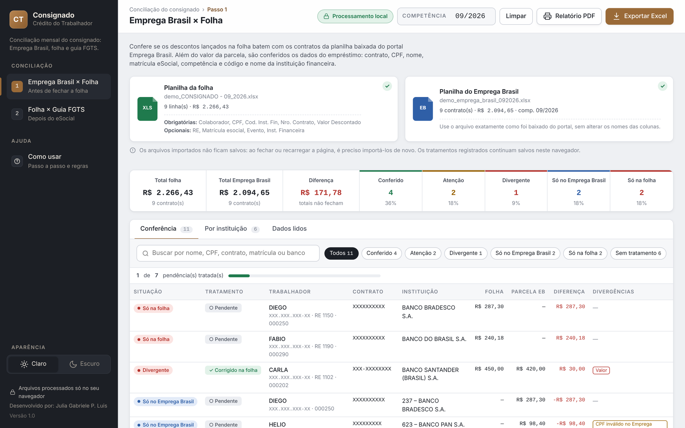

# Conciliação do Consignado · Crédito do Trabalhador

Ferramenta para o Departamento Pessoal conferir, todo mês, os descontos de empréstimo consignado do **Crédito do Trabalhador**, contrato a contrato, e calcular o desconto do consignado na rescisão.

### 👉 [Acessar a ferramenta](https://conciliacao-consignado.vercel.app/)

Imagem ilustrativa com dados fictícios. Nomes, CPFs e contratos aparecem mascarados.

## Os três passos

| Passo | O que confere | Quando usar |
|---|---|---|
| **1 · Emprega Brasil × Folha** | Se os descontos lançados na folha batem com os contratos da planilha baixada do portal Emprega Brasil | Antes de fechar a folha |
| **2 · Folha × Guia FGTS** | Se a guia do FGTS Digital trouxe exatamente o que foi descontado na folha | Depois do fechamento do eSocial |
| **3 · Desconto na rescisão** | Quanto descontar de cada contrato nas verbas rescisórias e se o valor lançado na rescisão está correto | No desligamento, antes do envio do S-2299 |

Nos Passos 1 e 2, cada contrato é localizado pelo **número do contrato**. Depois, a ferramenta confere os dados do empréstimo: CPF, nome, matrícula eSocial, competência, instituição financeira (código e nome) e valor da parcela.

## O que a ferramenta faz

- Confere, contrato a contrato, se os dados do empréstimo lançados na folha estão corretos e coincidem com a planilha do Emprega Brasil (Passo 1) e com a guia do FGTS Digital (Passo 2): contrato, CPF, nome, matrícula eSocial, competência, instituição financeira e valor da parcela
- Mostra a situação de cada contrato nos Passos 1 e 2: **Conferido**, **Atenção**, **Divergente**, **Só no Emprega Brasil**, **Só na guia** ou **Só na folha**
- Explica o que verificar em cada pendência, com orientações de acordo com as regras do Crédito do Trabalhador (Portaria MTE nº 435/2025, com a redação dada pela Portaria MTE nº 1.115/2026)
- Permite registrar o tratamento de cada pendência, com observação
- Apresenta os totais por instituição financeira e a quantidade de colaboradores
- Gera o Excel da conferência e um relatório em PDF para arquivo
- Transforma o PDF da guia do FGTS Digital em planilha Excel, mesmo sem fazer a conferência
- Calcula o desconto na rescisão (Passo 3): apura a remuneração disponível, aplica o percentual de garantia de cada contrato, limita ao saldo devedor e confere com o que foi lançado na rescisão, mostrando **Confere**, **Divergente**, **Não lançado** ou **Sem garantia**. Segue o art. 30 da Portaria MTE nº 435/2025, com a redação dada pela Portaria MTE nº 1.115/2026, e o Manual de Orientação ao Empregador (versão 2.1)
- Gera a memória de cálculo do desconto na rescisão em Excel e em PDF

## Requisitos

Funciona direto no navegador (Google Chrome, Microsoft Edge ou Firefox atualizados), sem instalar nada.

## Como usar

1. Escolha o **Passo 1** ou o **Passo 2** no menu lateral.
2. Confira a **competência** no topo da tela.
3. Importe a **planilha da folha** e o segundo arquivo: a **planilha do Emprega Brasil** (Passo 1) ou o **PDF do FGTS Digital** (Passo 2).
4. Clique em cada linha com pendência para ver o que está diferente e registrar o tratamento.
5. Ao terminar, salve a conferência em **Excel** ou em **PDF**.

No **Passo 3**, importe o Excel da rescisão e o CSV do Emprega Brasil (ou digite o percentual de garantia e o saldo devedor) para ver o desconto de cada contrato e conferir com o que foi lançado na rescisão.

As instruções completas estão no menu **Como usar**, dentro da ferramenta.

## Arquivos necessários

**Planilha da folha** (Excel exportado do sistema de folha)

| Colunas obrigatórias | Colunas opcionais |
|---|---|
| Colaborador, CPF, Cod. Inst. Fin, Nro. Contrato, Valor Descontado | RE, Matrícula esocial, Evento, Inst. Financeira |

**Dica:** salve a planilha da folha com a competência no nome, por exemplo `CONSIGNADO - 09_2026.xlsx`. Assim a ferramenta confere sozinha se a folha é do mesmo mês do Emprega Brasil ou da guia, e avisa se for de outro mês. Sem o mês no nome, ela pede que você confirme a competência.

**Planilha do Emprega Brasil**: o arquivo exatamente como é baixado do portal.

**PDF do FGTS Digital**: a Relação de Trabalhadores do Crédito do Trabalhador, baixada do portal.

**Demonstrativo da rescisão** (Passo 3): Excel exportado do sistema de folha, com as colunas de natureza da rubrica (eSocial), incidência de INSS, incidência de IRRF, proventos e descontos.

**Contratos do Emprega Brasil** (Passo 3): o CSV exportado da consulta de empréstimos do trabalhador, com o percentual de garantia e o saldo devedor. Sem o arquivo, os valores podem ser digitados na ferramenta.

## Uma competência por vez

A ferramenta confere uma competência de cada vez e não guarda histórico. Ao terminar as tratativas, salve o registro da conferência em **Excel** ou em **PDF**.

## 🔒 Privacidade

**Nenhum dado sai do computador de quem usa.** As planilhas e o PDF são lidos apenas no navegador. Nenhuma informação é enviada, armazenada ou utilizada pelo site.

Para comprovar: abra a ferramenta, **desligue a internet** e faça a conferência. Ela continua funcionando, porque nada precisa sair do seu computador. Os detalhes estão no menu **Segurança dos dados**, dentro da ferramenta.

Os arquivos importados são apagados ao fechar a página. Os tratamentos ficam salvos só no navegador de quem usa, até clicar em **Limpar**.

---

Utiliza as bibliotecas SheetJS, PDF.js e ExcelJS.

Desenvolvido por: Julia Gabriele P. Luis
